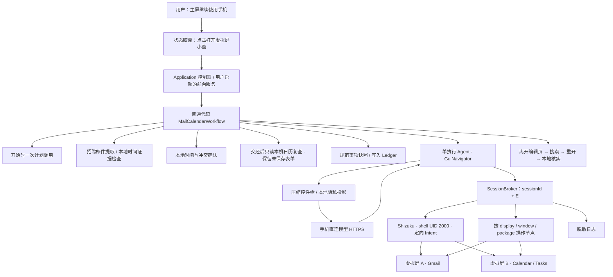

# 八爪鱼 · Octopus

在用户继续使用手机时，读取招聘邮件，将面试、笔试和补充材料事项整理到自己的日历与提醒中。

Whaletech take-home 项目，仓库沿用 WellPhone-Bluewhale 名称。目标是一个根据实时第三方 App 界面行动的 Android Agent。

**已接通邮件→事项提取→确认/冲突→日历或任务→重开核实，以及小窗接管、文字修改、交还后核对续跑的代码路径，通过 150 项 core、163 项 Robolectric Android 层和 8 项评估工具测试。真实 Gmail/Calendar、在线模型和主屏并行体验尚未验证；现已恢复真机/在线验收，等待设备接入，见 [验收状态](evaluation/DEVICE_STATUS.md)。** 实现进度见 [TASKS.md](TASKS.md)，可复现结果见 [本地检查](evaluation/LOCAL_CHECKS.md)。

补充系统层验证：Android 15 ARM64 模拟器中，生产 Shizuku 路径已创建双虚拟屏、读取预览、保留主屏焦点，并验证控制权交还、页面重建/切桌面后的会话保留和停止释放。实际触摸适配器通过 UID 匹配/拒绝探针；使用系统 App 测试，未验收真实 Gmail/Calendar。见 [模拟器报告](evaluation/EMULATOR_SMOKE.md)。

## 场景与第一版范围

用户说：“把招聘标签里的面试、笔试和材料截止日期整理到日历；时间冲突先问我。”用户同时在主屏用微信输入中文或刷信息流，后台虚拟屏中的 Agent 阅读已登录邮箱并操作日历。

- 确定起止时间的面试、笔试 → 日历事件与提醒。
- 截止事项 → 任务提醒，分别记录截止时间和提醒时间。
- 北京时间 → 用户本地 Australia/Sydney，按事件日期处理夏令时，备注保留原文。
- 时间不明确、低置信度、日程冲突 → 本地确认卡；胶囊提示等待确认，由用户点击进入。冲突允许“两个都保留 / 新事项标为待改约 / 只设提醒”。
- 创建前查重，保存后离开并重新打开记录核实；保存结果未知时先查询。
- 胶囊点击打开悬浮小窗，A/B 切换、原地接管后的单指触摸、双击放大/缩小与显式交还已接入。

候选 App 为 Gmail 和 Google Calendar（含 Tasks 界面）。Android 15/16 原生或接近原生系统优先，Android 14 为最低编译支持范围，**不代表已验证兼容**。登录、权限准备由用户完成。普通用户通过 Shizuku 无线调试配对启动 shell 服务，手机直接访问模型 API；电脑用于开发、观测与录屏。

候选真机是 **华为 Mate 60 Pro，系统分支与版本待确认**。用户已授权恢复设备与在线验证；当前电脑未识别到 ADB 设备，设备准入仍保留普通 APK、ADB、Shizuku、实际 Android API level 与显示隔离检查。

本次暂不包含招聘 App 筛选、支付、自动回信、自动扫描新邮件、复杂动画、ETA、前台协作模式、Root、通用任意 App 控制。API/IMAP 读邮件仅作为未来可选对照组。

## 架构



默认一名执行 Agent：先读授权范围，再逐项在 B 创建；A/B 分别拥有 sessionId、E 和窗口绑定。应用级 Mutex 保证日历只有一个写入者。主屏交互元数据和温度档位已接入保守/正常节奏，A/B 共用观察及动作准入门；双执行 Agent 留作扩展。代码交付与设备最终验收见 [交付说明](docs/DELIVERY.md)。

| 选择 | 原因与代价 |
| --- | --- |
| Kotlin + Compose，独立 JVM core | Android 系统接口容易接入；时区、权限代次、去重可脱离设备测试 |
| GUI 读取邮箱 | 真实作用于用户的 App 和账号；加载、控件树与版本差异提高实现成本 |
| 虚拟屏 + Shizuku shell，非 Root | 争取输入与焦点隔离；必须实测有效 display flags、App 多屏和 ROM 行为 |
| 事件用 ACTION_INSERT 预填，GUI 核对保存 | 避开脆弱日期选择器；不把直接写 Calendar Provider 当作 GUI 完成 |
| 恢复使用 CalendarContract 只读冲突查询 | 不导航离开人工未保存表单；需主动授权 READ_CALENDAR，只覆盖该账号本机已同步的可见日历 |
| 应用级控制器 + 用户启动前台服务 | 页面生命周期与后台任务分离；安静通知与停止入口，系统终止后重新授权 |
| 一次计划调用 + 单执行 Agent | 减少编排和调试成本，明确动作责任 |
| 会话控制代次 E | 接管立即拒绝旧指令；已提交的系统调用仍要等待结束 |

完整边界、接口、路线比较见 [架构设计](docs/ARCHITECTURE.md)，实现顺序见 [任务清单](TASKS.md)。

## 邮件到日历如何闭环

1. 每轮明确账号、招聘标签、目标日历和任务列表。Gmail GUI 搜索先填文本、再单独提交；在本地确认真实预览中的账号和标签。
2. 本地筛选招聘候选与敏感内容，再把脱敏正文交给模型提取。来源由手机绑定，规范事项持久化，重跑不重新生成身份。
3. 独立时间检查器核对原文与模型 UTC 结果。自动核对目前仅支持明确的北京时间、绝对日期和 24 小时时间；其他表达交人工确认。悉尼按事件日期采用 IANA 夏令时规则。
4. 先按备注中的来源标记查重。日程覆盖不完整也需要用户确认；冲突选择绑定事项及可见忙碌区间，发生变化重新询问。旧日程保持原样。
5. 事件经定向 `ACTION_INSERT` 预填，再 GUI 核对；任务经 Tasks GUI 填写。模型不能点击 Save、操作完成复选框或用编辑框回车绕过保存门。普通代码先持久化 `WRITE_PENDING`，再执行一次最终保存。
6. 离开编辑页，提交标记搜索并重新打开结果。本地核对账户、目标日历/列表、标题、日期、时间、提醒和完整备注；未满足证据写 `UNKNOWN`。重跑先查真实记录，保存回执未知时不自动补点 Save。

GUI 适配器尚未在指定 App 版本验证。每轮默认最多读取 **3 封可见且能识别的候选邮件**，不遍历全部历史邮件；缺完整发送时间需本地补充确认。详情缺年份、账户或提醒字段，搜索不支持标记，以及控件树截断，都可能使流程停止或保持未知。标记查重覆盖本应用创建的事项；无标记的手工事件按时间冲突处理。当前不验证云同步与通知实际触发。

## 目录与运行

```text
app/                    配置/确认页、胶囊、Shizuku、GUI 端口、模型、SQLite/Keystore
core/                   生产工作流、时间证据、GUI 核实、会话仲裁、写入状态机与测试
docs/                   架构、AI 协作记录
evaluation/             AC01–AC12、测试邮件、真实设备结果（未采集）
tools/                  设备预检与日志统计
```

固定构建基线：JDK 17、Gradle 8.11.1、AGP 8.9.2、Kotlin 2.1.20、compile/target SDK 35、Shizuku API 13.1.5。选择一组有明确兼容关系的版本，暂不追逐最新依赖。

```bash
# 配置 Android SDK 路径到 local.properties：sdk.dir=/your/android-sdk
# 使用 JDK 17
./gradlew :core:test :app:testDebugUnitTest :app:assembleDebug :app:lintDebug
adb install -r app/build/outputs/apk/debug/app-debug.apk
python3 tools/device_preflight.py --output evaluation/runs/preflight.json
```

手机准备：开发者选项、无线调试与 Shizuku 配对；每次重启后重新启动 Shizuku；手动启用八爪鱼无障碍服务。小米等 ROM 的额外“USB 调试（安全设置）”要求待实测。可选状态胶囊需要悬浮权限；没有该权限仍可使用工作台。无需 Root、无需切换输入法。

接管修改时间后，可在工作台主动“授权只读日历冲突检查”，只申请 READ_CALENDAR。恢复阶段读取配置账号的可见日历实例，冲突信息留在本机；未授权或范围不完整会明确请用户人工核对，后台不弹授权框。没有 WRITE_CALENDAR，保存仍通过目标 App GUI。

工作台配置步骤：

1. 在可见工作台连接 Shizuku、开启无障碍，创建 A/B（同时启动后台会话服务），在真实预览中完成 Gmail/Calendar 登录和必要权限准备。可随时点“停止后台会话”释放全部显示；通知可见时也提供停止入口。
2. 填写模型完整 HTTPS Chat Completions 地址、模型名称和 API Key；服务须支持 JSON object 响应。保存后密钥只留在手机 Keystore 加密存储中。可主动测试已保存连接，仅发送合成任务，不操作 App；测试可取消。尚未在线验证任何供应商。
3. 填写与 App 界面一致的账号、招聘标签、日历名称和任务列表名称，输入目标；本轮勾选授权，开始整理。
4. 开启胶囊后点击打开悬浮小窗；默认只读，可切换 A/B。点击“原地接管当前任务”，待在途操作结束后单指操作；双击画面或点击按钮放大/缩小。
5. 在目标 App 打开编辑页，点“输入文字”，选择字段并修改。可先自行保存，也可将当前事项的表单交还，核对后在本地确认由 Agent 保存。
6. 小窗“确认/设置”由用户主动进入工作台处理确认卡。隐藏保留接管；交还全部相关会话后自动重新观察，沿用能核对的修改，继续本轮未完成事项。无法识别的编辑页保留现场，请先手动处理。可点“结束本轮”退出，再次开始需要重新授权。

首次设备实验使用专用测试标签和日历。显示创建成功只证明拿到了虚拟屏；有效 flags、前台中文输入、声音和弹窗仍须单独验证。

工作台默认“自适应后台节奏”，只使用主屏窗口类型、交互事件类型和温度元数据；不会读取主屏文字或截图。信号缺失、输入法出现、近期交互或温度升高时保守。无人查看虚拟屏时停止 JPEG 编码；只读显示缓冲仍排空。策略参数与未知边界见 [PACING.md](docs/PACING.md)。固定频率开关仅用于对照实验，需在本轮任务开始前选择；不报告设备性能收益。

## 悬浮小窗的交互边界

窗口只改变预览，不重建/移动后台 App。每段触摸绑定 sessionId、E、目标 displayId、App UID 和预览版本，整段 DOWN→MOVE→UP/CANCEL 占用一个人工输入名额；交还需等终止事件结算。缩放映射排除黑边，切任务、放大、拖动标题栏、隐藏和关闭都取消旧手势。底层隐藏 API 不可用时停止，不回退到主屏。

双击预留给放大，因此单次点击约等待 300ms 才派发；拖动超过阈值后开始转发，长按需考虑本地识别与目标 App 的额外识别延迟。支持单指点击、拖动和按住，最长一段 15 秒；双指或队列拥塞取消。工作台内的静态预览继续只读。

接管后点“输入文字”，在本地面板选择字段、编辑中文/多行或清空，确认后通过 ACTION_SET_TEXT 写回并读回核对。虚拟屏 IME 保持隐藏；编辑面板仅在用户主动打开时临时请求本地键盘焦点，关闭后释放，不更换系统输入法。写回只证明字段内容，不代表 App 已保存、搜索或发送。

草稿只留内存，不直接发模型或记正文日志；密码字段不提供编辑。字段身份、原值、窗口、E 或预览版本变化会使草稿失效。切屏、隐藏、放大、交还均丢弃未确认编辑；已提交动作等待结算，结果未知时不自动重试。后续 Agent 仍只能按授权范围观察，人工新增文字不会扩大邮件读取或出站范围。

本轮任务在接管时保留检查点。交还后重新读取当前页面，保留支持的标题、备注、日期、时间、提醒和截止设置。事件采用控件中的新提前量；任务分别读取通知时间与截止，提醒必须严格早于新截止。没有独立截止控件时，读取备注中唯一完整的“截止：”行；原邮件提取快照保持。新设置在确认卡单独展示，不填回旧值。事件继续按新时间复查冲突，确认后再查一次，再保存并重开核实；已保存事项只核实。无效或模糊时间、夏令时歧义、账号变化、来源标记丢失或未知保存保留页面。修订持久化用于后续去重，旧冲突审批失效。字段与备注的优先级及兼容边界见 [安全恢复](docs/RESUME.md)。

以上是已编译接入的实现约束，实际触摸、焦点、UID 定向注入、中文键盘和 ROM 兼容性均待真机验收。执行控制器归 Application 持有；用户在可见工作台创建会话时启动前台服务，切走/重建页面不取消任务。服务终止会撤销输入并关闭会话，进程退出后不自动恢复；OEM 后台行为待验证，见 [运行生命周期](docs/LIFECYCLE.md)。31 项 SDK 35 窗口集成测试、8 项 SDK 34/35 触摸契约测试、30 项文字适配器、52 项恢复集成和 14 项只读日历查询测试；输出小窗/放大窗口/文字面板的合成渲染图。设计与测试细节见 [小窗与触摸](docs/OVERLAY.md)。

## 不打扰与隐私

所有观察与动作绑定会话，禁止默认屏输入；控件输入优先 ACTION_SET_TEXT，搜索另行提交。接管先撤销 E、停止接收新动作，待已提交动作结束再允许人工操作，显式交还后重新观察。

只向模型发送本地筛选后的招聘邮件内容；验证码、凭证、无关邮件和主屏内容不出站。初始收件箱截图不会直接上传。邮件是待处理数据，不能改变工具权限。API 密钥使用 Android Keystore 加密存储，不进入仓库或日志。

焦点、输入法、主屏流畅度、后台音频、Toast、权限弹窗和 ANR 都在统一验收中测量。评估 AppOps PLAY_AUDIO / TAKE_AUDIO_FOCUS / VIBRATE 时，这些限制按 UID 生效，修改前记录原值并恢复，不能声称只影响虚拟屏。

## Evaluation 与提交

统一采用 [AC01–AC12](evaluation/README.md)。自动化单元测试与真实 App 验收分开报告，未测项标为“待验证”。真实评估比较无 Agent、固定频率、负载调速三组，每组至少三轮，统计结果正确率、核实完成时间、前台 jank、接管耗时、错误路由与重复写入。

离线准备：python3 tools/prepare_demo.py --output evaluation/runs/demo 生成三封合成 .eml、冲突 .ics 和预期结果，不发送邮件。可用 --start-date YYYY-MM-DD 推迟首封面试日期并重新换算夏令时。手机可主动导出脱敏日志，tools/summarize_events.py 分别统计动作/模型耗时及工作流记录的核实结果。tools/local_evaluation.py 从实际 JUnit/lint/APK 生成证据摘要，--include-tools 同时执行工具测试；GitHub CI 归档同一份摘要。

本地结果：**321 项测试通过（150 项 core、163 项 Android 层、8 项评估工具），调试 APK 构建与签名校验通过**。包括邮件到日历、去重、未知保存恢复、文字修改、交还后的新观察/票据、保留修订与剩余事项继续。core 使用模拟端口与合成控件树；Android 层运行生产 View、适配器、GUI 端口、Navigator、Broker 和本地存储。窗口、无障碍树/回执、shell、模型决定和输入接收端由测试模拟；未连通真实 WorkbenchController→Shizuku→App，不能报告设备成功率。详见 [本地检查记录](evaluation/LOCAL_CHECKS.md)。

已交付：可构建仓库、调试 APK、本地评估、演示准备器、关键取舍和 [AI 协作记录](docs/AI_COLLABORATION.md)。题目还需同机真实执行的原始录屏、90–120 秒演示与实测结果；这些等待设备接入后验证，不报告设备成功率和性能收益。

技术答辩可按 [30 分钟提纲](docs/DEFENSE.md) 展开。

## 参考

- [Shizuku API / UserService](https://github.com/RikkaApps/Shizuku-API) 与 [普通用户启动说明](https://shizuku.rikka.app/guide/setup/)。
- [scrcpy 虚拟屏](https://github.com/Genymobile/scrcpy/blob/master/doc/virtual-display.md)：参考多屏实现，不把镜像窗口当作独立输入隔离证明。本仓库当前不打包 scrcpy。
- [Calendar 预填 Intent](https://developer.android.com/identity/providers/calendar-provider#intents)、[无障碍动作](https://developer.android.com/reference/android/view/accessibility/AccessibilityNodeInfo.AccessibilityAction)。
- [AGP 8.9 构建兼容性](https://developer.android.com/build/releases/agp-8-9-0-release-notes)、[FrameTimeline](https://perfetto.dev/docs/data-sources/frametimeline)。

仓库原始代码许可尚待所有者选择；未附加未经授权的第三方源码。Gradle wrapper 沿用其上游 Apache-2.0 许可，见 [第三方说明](docs/THIRD_PARTY.md)。
