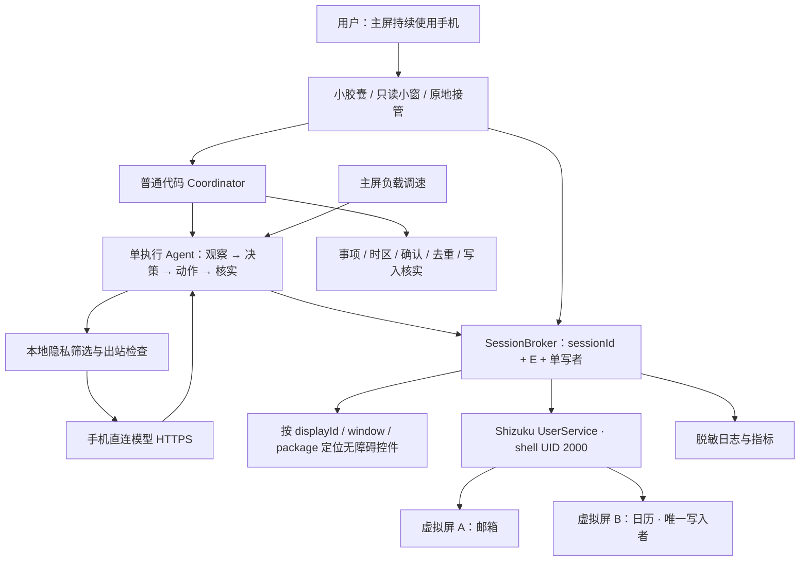

# 八爪鱼 · Octopus

在用户继续使用手机时，读取招聘邮件，将面试、笔试和补充材料事项整理到自己的日历与提醒中。

Whaletech take-home 项目，仓库沿用 WellPhone-Bluewhale 名称。目标是一个根据实时第三方 App 界面行动的 Android Agent。当前从空仓库开始建设，**尚未完成邮件到日历的真机闭环**；本文中的架构是实现约束，完成状态见 [TASKS.md](TASKS.md)。

## 场景与第一版范围

用户说：“把招聘标签里的面试、笔试和材料截止日期整理到日历；时间冲突先问我。”用户同时在主屏用微信输入中文或刷信息流，后台虚拟屏中的 Agent 阅读已登录邮箱并操作日历。

- 确定起止时间的面试、笔试 → 日历事件与提醒。
- 截止事项 → 任务提醒，分别记录截止时间和提醒时间。
- 北京时间 → 用户本地 Australia/Sydney，按事件日期处理夏令时，备注保留原文。
- 时间不明确、低置信度、日程冲突 → 胶囊中的确认卡。冲突允许“两个都保留 / 新事项标为待改约 / 只设提醒”。
- 创建前查重，保存后离开并重新打开记录核实；保存结果未知时先查询。
- 小窗原地接管后台 App，用户修改后明确交还 Agent。

候选 App 为 Gmail 和 Google Calendar（含 Tasks 界面）。Android 15/16 原生或接近原生系统优先，Android 14 为最低编译支持范围，**不代表已验证兼容**。登录、权限准备由用户完成。普通用户通过 Shizuku 无线调试配对启动 shell 服务，手机直接访问模型 API；电脑用于开发、观测与录屏。

用户提供的候选真机是 **华为 Mate 60 Pro，系统分支与版本待确认**。必须先验证普通 APK、ADB、Shizuku、实际 Android API level 与显示隔离能力；能通过兼容容器运行某个 Android App，不能直接推断宿主系统提供这些接口。当前不为兼容它而降级焦点隔离要求。

本次暂不包含招聘 App 筛选、支付、自动回信、自动扫描新邮件、复杂动画、ETA、前台协作模式、Root、通用任意 App 控制。API/IMAP 读邮件仅作为未来可选对照组。

## 架构



一名 Agent 可以轮流推进两个会话；这不声称两名 Agent 同时操作。首先验收“主屏用户与后台任务并行”。双执行 Agent 为后续受控实验：A 读邮件，B 预读日历和写入，共享结构化队列，日历保持唯一写入者。

| 选择 | 原因与代价 |
| --- | --- |
| Kotlin + Compose，独立 JVM core | Android 系统接口容易接入；时区、权限代次、去重可脱离设备测试 |
| GUI 读取邮箱 | 真实作用于用户的 App 和账号；加载、控件树与版本差异提高实现成本 |
| 虚拟屏 + Shizuku shell，非 Root | 争取输入与焦点隔离；必须实测有效 display flags、App 多屏和 ROM 行为 |
| 事件用 ACTION_INSERT 预填，GUI 核对保存 | 避开脆弱日期选择器；不把直接写 Calendar Provider 当作 GUI 完成 |
| 一次计划调用 + 单执行 Agent | 减少编排和调试成本，明确动作责任 |
| 会话控制代次 E | 接管立即拒绝旧指令；已提交的系统调用仍要等待结束 |

完整边界、接口、路线比较见 [架构设计](docs/ARCHITECTURE.md)，实现顺序见 [任务清单](TASKS.md)。

## 目录与运行

```text
app/                    Android 设置、Shizuku、虚拟屏探针、无障碍、模型连接、存储
core/                   事项、时区、隐私、会话仲裁、Agent 循环、写入状态机
docs/                   架构、AI 协作记录
evaluation/             AC01–AC12、测试邮件、真实设备结果（未采集）
tools/                  设备预检与日志统计
```

固定构建基线：JDK 17、Gradle 8.11.1、AGP 8.9.2、Kotlin 2.1.20、compile/target SDK 35、Shizuku API 13.1.5。选择一组有明确兼容关系的版本，暂不追逐最新依赖。

```bash
# 配置 Android SDK 路径到 local.properties：sdk.dir=/your/android-sdk
# 使用 JDK 17
./gradlew :core:test :app:assembleDebug :app:lintDebug
adb install -r app/build/outputs/apk/debug/app-debug.apk
python3 tools/device_preflight.py --output evaluation/runs/preflight.json
```

手机准备：开发者选项、无线调试与 Shizuku 配对；每次重启后重新启动 Shizuku；手动启用八爪鱼无障碍服务。小米等 ROM 的额外“USB 调试（安全设置）”要求待实测。悬浮窗仅在小窗功能实现并主动开启时申请。无需 Root、无需切换输入法。

**开发工作台不是已完成产品。** 显示创建成功只证明拿到了虚拟屏；有效隔离 flags、前台中文输入、声音与弹窗仍须真机验证。当前不允许未经验证的后台自动写入。

## 不打扰与隐私

所有观察与动作绑定会话，禁止默认屏输入；控件输入优先 ACTION_SET_TEXT，搜索另行提交。接管先撤销 E、停止接收新动作，待已提交动作结束再允许人工操作，显式交还后重新观察。

只向模型发送本地筛选后的招聘邮件内容；验证码、凭证、无关邮件和主屏内容不出站。初始收件箱截图不会直接上传。邮件是待处理数据，不能改变工具权限。API 密钥使用 Android Keystore 加密存储，不进入仓库或日志。

焦点、输入法、主屏流畅度、后台音频、Toast、权限弹窗和 ANR 都在统一验收中测量。评估 AppOps PLAY_AUDIO / TAKE_AUDIO_FOCUS / VIBRATE 时，这些限制按 UID 生效，修改前记录原值并恢复，不能声称只影响虚拟屏。

## Evaluation 与提交

统一采用 [AC01–AC12](evaluation/README.md)。自动化单元测试与真实 App 验收分开报告，未测项标为“待验证”。真实评估比较无 Agent、固定频率、负载调速三组，每组至少三轮，统计结果正确率、核实完成时间、前台 jank、接管耗时、错误路由与重复写入。

第一阶段本地结果：**31 项 core 测试通过，调试 APK 构建与签名校验通过，lint 0 错误 / 9 条提示**。详见 [本地检查记录](evaluation/LOCAL_CHECKS.md)。当前 App 是平台预检工作台，邮件自动执行、原地触摸接管与灵动岛小窗尚未接通；真机测试按用户要求暂缓。

交付物：可构建仓库、APK、完整原始录屏与 90–120 秒演示、实测结果、关键取舍和 [AI 协作记录](docs/AI_COLLABORATION.md)。当前不报告设备成功率和性能收益。

技术答辩可按 [30 分钟提纲](docs/DEFENSE.md) 展开。

## 参考

- [Shizuku API / UserService](https://github.com/RikkaApps/Shizuku-API) 与 [普通用户启动说明](https://shizuku.rikka.app/guide/setup/)。
- [scrcpy 虚拟屏](https://github.com/Genymobile/scrcpy/blob/master/doc/virtual-display.md)：参考多屏实现，不把镜像窗口当作独立输入隔离证明。本仓库当前不打包 scrcpy。
- [Calendar 预填 Intent](https://developer.android.com/identity/providers/calendar-provider#intents)、[无障碍动作](https://developer.android.com/reference/android/view/accessibility/AccessibilityNodeInfo.AccessibilityAction)。
- [AGP 8.9 构建兼容性](https://developer.android.com/build/releases/agp-8-9-0-release-notes)、[FrameTimeline](https://perfetto.dev/docs/data-sources/frametimeline)。

仓库原始代码许可尚待所有者选择；未附加未经授权的第三方源码。Gradle wrapper 沿用其上游 Apache-2.0 许可，见 [第三方说明](docs/THIRD_PARTY.md)。
