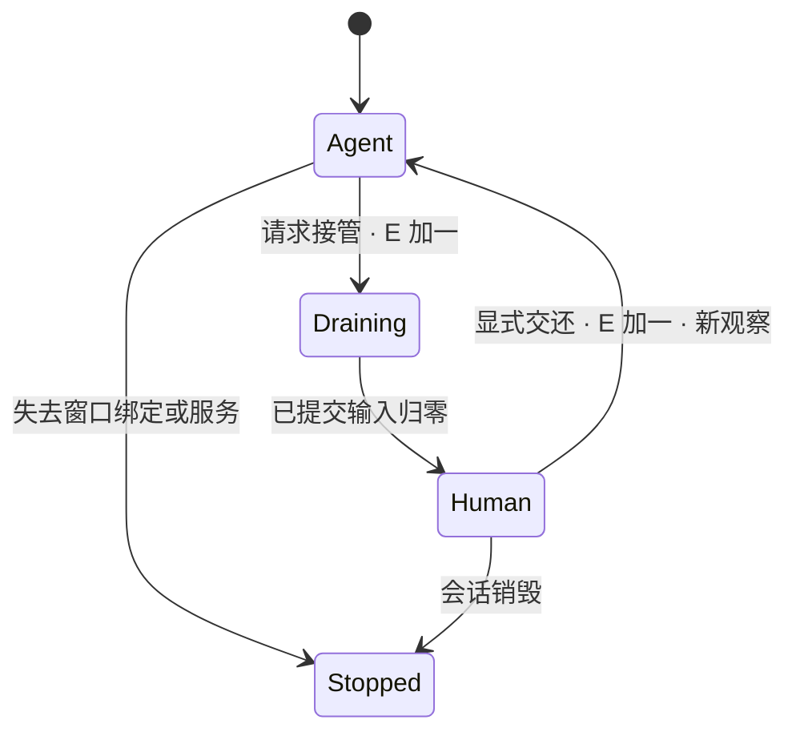

# 需求与关键决策

## 模块和端口

| 模块 | 职责 | 当前接入方式 |
| --- | --- | --- |
| Coordinator | 一次计划调用、收集事项、确认、汇总 | 普通代码；执行循环通过端口接入 |
| AgentRunner | 新观察→单步决策→受控动作；加载/弹窗和预算 | core，不直接持有 Android API |
| SessionBroker | 会话身份、E、单写者、动作去重、接管排空 | core；所有输入通道必须经过同一仲裁 |
| Accessibility | displayId/package/window 三重定位、带编号节点 | Android；主屏节点不作为默认回退 |
| Shell bridge | UID 2000 创建 VD、消费帧；后续定向输入 | Shizuku AIDL UserService；不开放任意 shell 给模型 |
| Item/WriteLedger | 事项验证、时区、冲突、来源指纹、保存核实 | core + Android SQLite 持久化端口 |
| ModelClient | 手机 HTTPS、严格 JSON 解码、单步响应 | 不预设厂商；未配置时拒绝执行 |
| OverlayHost | 胶囊、只读预览、接管确认、人控、交还 | 手机；观察窗口不控制 VD 生命周期 |
| LoadGovernor | 主屏输入/帧负载的低频元数据→取帧/动作节奏 | core 策略；真机信号待接入 |
| Journal | 单调时钟、sessionId/E/actionId、状态与耗时 | 不记录邮件正文、密钥、完整链接 |

## 会话与动作

每个新会话使用新 UUID，displayId 不作长期身份。观察绑定 sessionId、E、observationId、windowId、package 和采集时间，节点编号仅在该观察中有效。树与截图采集存在时间差；动作前复查窗口、包、节点和新鲜度。

动作集合限定为 ClickNode、SetText、SubmitSearch、Scroll、Wait、AskUser、Finish；定向 Back 和坐标输入待 shell 输入适配器接入，坐标输入必须额外带预览变换版本。Finish 表示循环停止，只有持久化核实通过的事项可宣告成功。

默认总决策预算 40 步，同状态至多两次失败，等待总量有上限。每步 ≤5 秒仅是起始目标，模型时延待实测。加载用可取消等待与重新观察；弹窗仍以当前观察中的控件决定，不写默认点击坐标。

接管状态：

新动作准入和计数必须原子完成。接管后的旧模型响应被 E 拒绝；系统已接受的动作不能撤销，排空结束前不授权人工。第一下接管手势不补发。日历停住时允许切换到独立的邮箱工作。关闭窗口不等于交还。用户把同一个目标 App 打开到主屏导致 Activity 重用时，停掉失效会话，不追抢窗口。

## 事项与写入

字段：类型、标题、原文起止时间、原文时区与 IANA zone、标准 UTC 起止、截止日期/时刻、单独的 remindAt、会议链接引用、来源邮件、置信级别、证据与歧义。模型置信度不当作校准概率。缺日期/时区、CST、相对日期、仅写“下班前”、缺结束时间都需要确认。

来源：accountKey、sender、subject、完整 sentAt、正文摘要 hash 和可选 GUI 定位器；取不到 Message-ID 时使用规范化字段组成指纹。来源不稳定时停止自动去重判断。

时区使用 Asia/Shanghai 与 Australia/Sydney 的区域规则，禁止写死 UTC+10。截止时刻与通知时刻分别存储。提醒事项 App 可能只支持日期截止，精确原文放备注，通知由独立提醒时间表达并实测。

事件创建先 GUI 查找旧项，再通过 ACTION_INSERT 预填到指定虚拟屏的指定日历 App；核对账户、日期、提醒再保存。任务走 Tasks GUI。日历只读检查与插入都限定到用户选定账户/日历；不添加参与人。系统时钟任意日期闹钟能力另行实测，当前不实现。

写入状态：PREPARED → WRITE_PENDING → VERIFIED / UNKNOWN。保存前持久化 PENDING；保存响应丢失或进程退出，查询真实 App 后决定，禁止自动重放 Save。VERIFIED 要求离开后重开记录及字段匹配，云同步另报。并发唯一键锁住来源+事项身份，不能仅靠一次查重。

冲突由本地半开区间重叠判断，保存前再读一次。三个选项：保留双方；新项加“待改约”但保留原定时间；只建立提醒。确认绑定事项内容摘要及 sessionId/E，过期后重新确认。现有事件不删改，邮件回复只可起草。

## 隐私与负载

用户选择招聘标签；本地看最小必要 sender/subject 判断候选与敏感邮件，再允许正文读取。无法可靠识别时请求用户确认，宁可漏读。专用标签减少隐私风险，仍不能保证关键词过滤覆盖所有凭证类邮件。首屏收件箱截图与无关节点不得直接发模型。链接用本地 LINK 引用映射，日历私密标题替换为 busy，日志只留结构。

取帧降频只减少保留、编码和模型请求，生产者缓冲仍及时释放。初始正常预算 2 帧/秒、动作间隔 0.5 秒；保守预算 0.5 帧/秒、间隔 1 秒，均待测。输入法可见或高负载进入保守状态，连续稳定采样后恢复；取不到可信信号时固定保守模式，不报告自适应收益。

## 路线比较

| 路线 | 优点 | 主要代价 / 选择 |
| --- | --- | --- |
| 前台无障碍 | 开发快、控件成熟 | 占用用户当前屏；只用于设置和调试，不满足核心并行 |
| 模拟器 | 容易重置与自动化 | 不是用户正在使用的手机和账号环境 |
| 云手机 | 远程运行 | 账号迁移、隐私、网络与登录成本 |
| 第二台手机 | 天然物理隔离 | 额外设备，失去单机体验 |
| 第二用户/工作资料 | 数据隔离 | 账户和数据空间不同，也未自然解决并发前台 |
| 虚拟屏 + shell | 同机同账号，可探测独立焦点 | 选用；非 SDK 接口、ROM、应用多屏待实测 |
| Root 系统级 | 控制更完整 | 普通用户安装门槛与系统风险过高 |

## 单 / 双 Agent 与实测

| 项目 | 单 Agent（默认） | 双 Agent（可选） |
| --- | --- | --- |
| 分工 | 同一循环推进邮箱和日历 | 邮箱生产事项，日历消费并唯一写入 |
| 收益 | 责任明确、易调试 | 网络/加载等待可重叠 |
| 代价 | 观察与推理可能串行等待 | token、CPU、帧采集和队列一致性成本 |
| 对照 | 同样三封邮件、相同设备/模型/主屏路径 | 相同条件，至少三轮，报告真实耗时及前台代价 |

不能用两个小窗的存在推断双 Agent 更快；只有真实输出核实之后计完成时间。

## 优先验证的技术矛盾

- shell UID 并不自动保证不抢焦点：必须核对系统实际 flags 与持续中文输入。Android 14/15/16 的可用字段不同，拒绝静默降级到不隔离的显示。
- Shizuku UserService 的 Context 非普通应用 Context，一部分框架 API 不可用：VD 探针使用 shell 包上下文，失败带原因返回；必要时换成基于 scrcpy 受审查的显示适配器。
- ACTION_SET_TEXT 不能保证搜索已提交：分离 SubmitSearch，优先 ACTION_IME_ENTER 或当前观察中的搜索按钮。
- Google Calendar 的事件 Intent 不能替代 Tasks 写入：任务路径单独开发与验收。
- 既要 GUI 阅读又希望完全不碰无关元数据存在边界：使用专用标签；最小元数据只在本地处理。
- “即时暂停”只能立即撤销新动作权限：已经进入系统的调用需要结算，人工接管单独等待排空。
- 电脑镜像是可选只读观察者；断开它不影响手机执行。shell/无障碍死亡则停止相关动作。
