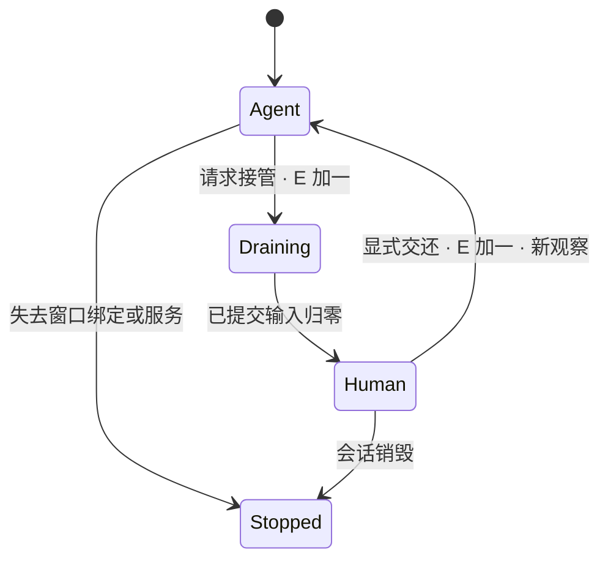

# 需求与关键决策

## 模块和端口

| 模块 | 职责 | 当前接入方式 |
| --- | --- | --- |
| Coordinator / MailCalendarWorkflow | 一次计划、提取、确认、查重、写入与汇总 | 普通代码；WorkbenchViewModel 已接入 |
| GuiNavigator | 新观察→单步决策→受控动作；加载/弹窗和预算 | core；生产工作流使用，AgentRunner 保留基础协议测试 |
| SessionBroker | 会话身份、E、单写者、动作去重、接管排空 | core；所有输入通道必须经过同一仲裁 |
| Accessibility | displayId/package/window 三重定位、带编号节点 | Android；主屏节点不作为默认回退 |
| Shell bridge | UID 2000 创建 VD、消费帧、按屏日历 Intent | Shizuku AIDL UserService；绑定 E，不开放任意 shell 给模型 |
| CanonicalStore / WriteLedger | 固定提取快照、时区、来源身份、保存状态 | Android SQLite v2；旧写入记录显式迁移保留 |
| GmailGuiPort / CalendarGuiPort | 标签搜索、正文读取、日历/Tasks 填写、重开证明 | Android；控件版本适配与可见证据待真机确认 |
| ModelClient | 手机 HTTPS、严格 JSON 解码、单步响应 | 不预设厂商；未配置时拒绝执行 |
| StatusCapsule / UserReviews | 状态胶囊、本地时间/冲突确认 | 已接入胶囊与虚拟屏小窗，人工触摸经过独立整段 Broker 准入 |
| LoadGovernor | 主屏输入/帧负载的低频元数据→取帧/动作节奏 | core 策略；真机信号待接入 |
| Journal | 单调时钟、sessionId/E/actionId、状态与耗时 | 不记录邮件正文、密钥、完整链接 |

## 会话与动作

每个新会话使用新 UUID，displayId 不作长期身份。观察绑定 sessionId、E、observationId、windowId、package 和采集时间，元素包含 resourceId、parentId、边界和交互属性。模型接收压缩的编号元素 JSON；截图当前仅本地预览，未接入标注截图出站。模型返回后重新采集；投影或窗口发生变化就丢弃旧决策，派发前再由 Android 检查当前节点与控制代次。

动作集合限定为 ClickNode、SetText、SubmitSearch、Scroll、Wait、AskUser、Finish；定向 Back 和坐标输入待 shell 输入适配器接入，坐标输入必须额外带预览变换版本。Finish 表示循环停止，只有持久化核实通过的事项可宣告成功。

三封邮件流程共用最多 80 次决策预算，每个阶段最多 24 次，同阶段两次动作失败即停止；基础 AgentRunner 默认 40 次。模型 HTTP 连接/读取超时为 10/30 秒，观察派发新鲜度上限 5 秒；5 秒是本地防陈旧门限，不是实测模型响应指标。加载用可取消等待与重新观察；弹窗仍依据可用控件，不写默认点击坐标。模型调用返回后还需通过 E 检查。

接管状态：

新动作准入和计数原子完成。接管后的旧模型响应被 E 拒绝；系统已接受的动作不能撤销，排空结束前不授权人工。当前工作台可独立测试 A/B 撤销、排空与交还；单工作流遇到相关会话撤销会停止，不承诺另一个执行循环继续。小窗接管必须点击独立按钮；只读阶段的触摸不补发。关闭窗口不自动交还。用户把目标 App 打开到主屏导致绑定丢失时停掉失效会话，不追抢。

胶囊与小窗都是非焦点悬浮窗口。用户点击胶囊查看现有虚拟屏，明确接管后才转发单指触摸；双击画面放大/缩小，隐藏不交还。确认卡由小窗“确认/设置”按钮进入。普通 Activity 的生命周期不保证长期后台驻留，进程退出后不自动恢复执行。详见 [触摸协议与边界](OVERLAY.md)。

## 事项与写入

字段：类型、标题、原文起止时间、原文时区与 IANA zone、标准 UTC 起止、截止日期/时刻、单独的 remindAt、会议链接引用、来源邮件、置信级别、证据与歧义。模型置信度不当作校准概率。缺日期/时区、CST、相对日期、仅写“下班前”、缺结束时间都需要确认。

来源：accountKey、sender、subject、完整 sentAt、正文摘要 hash 和可选 GUI 定位器；取不到 Message-ID 时使用规范化字段组成指纹。来源不稳定时停止自动去重判断。

CanonicalStore 以来源指纹保存首次提取快照，事项身份由来源与序号确定，后续重跑不再请求模型重新划分事项。人工修正和冲突选择写入同一快照。不单独保存完整邮件正文，但事项原文和证据可能包含邮件段落。SQLite 存在应用私有目录并排除备份，当前没有额外数据库加密。

时区使用 Asia/Shanghai 与 Australia/Sydney 的区域规则，禁止写死 UTC+10。截止时刻与通知时刻分别存储。提醒事项 App 可能只支持日期截止，精确原文放备注，通知由独立提醒时间表达并实测。

TimeGrounding 独立于模型置信度：当前仅自动核对明确北京时间、单个绝对日期、24 小时起止/截止，以及“提前 N 分钟/小时”。缺失或不支持的表达进入人工确认；高置信度但 UTC 转换错误也会被拦下。确定时间的事件未指定提醒时默认提前 15 分钟，并在设置页告知；截止事项要求明确提醒时间。

事件创建先 GUI 查找旧项，再通过 ACTION_INSERT 预填到指定虚拟屏的指定日历 App；核对账户、日期、提醒再保存。任务走 Tasks GUI。日历只读检查与插入都限定到用户选定账户/日历；不添加参与人。系统时钟任意日期闹钟能力另行实测，当前不实现。

写入状态：PREPARED → WRITE_PENDING → VERIFIED / UNKNOWN。全应用 Mutex 保证单写者，数据库键保证来源事项身份。先搜索备注标记再查冲突，避免和自己重复冲突。模型无 Save、任务完成复选框、编辑框 IME 提交权限；准备票据只能消费一次。保存前持久化 PENDING，回执丢失/取消后记 UNKNOWN，重跑先查目标，禁止自动重放 Save。已核实记录被用户删除时也不自动重建。

核实分两阶段：先定向离开编辑页，明确提交标记搜索，再只读打开结果。确定性检查账户、目标日历/列表、标题、起止日期/时间、提醒和完整备注。备注与子控件不参与日期时间字段核实；仅看到原文时间或来源标记无法证明成功。Tasks 若只提供编辑详情，可以重开后读取，但不执行修改或保存。未知/截断/缺字段返回 UNKNOWN，不由模型 Finish 授权完成。通知触发、云同步仍须单独实测。

冲突由本地半开区间重叠判断，填写前再读一次；无法证明全天日程覆盖完整也需要用户决定。三个选项：保留双方；新项加“待改约”但保留原定时间；只建立提醒。审批摘要绑定事项、可见忙碌区间与覆盖状态，改变后重新询问；确认卡还绑定 sessionId/E。第三方 GUI 无事务快照，最后检查到保存之间仍有竞态。现有事件不删改，不发送邀请或自动回信；本版也不生成回复草稿。

## 隐私与负载

用户选择招聘标签；本地看最小必要 sender/subject 判断候选与敏感邮件，再允许正文读取。无法可靠识别时请求用户确认，宁可漏读。专用标签减少隐私风险，仍不能保证关键词过滤覆盖所有凭证类邮件。首屏收件箱截图与无关节点不得直接发模型。链接用本地 LINK 引用映射，日历私密标题替换为 busy，日志只留结构。

LoadGovernor 的 core 策略保留正常/保守档位，但尚未接入主屏信号和工作流。当前工作台预览约每秒请求一次帧，动作后固定等待，模型按需决策；不报告自适应收益。后续降频只减少保留、编码和模型请求，显示生产者缓冲仍须及时释放。

## 精简接口

| 接口 | 主要消息与约束 |
| --- | --- |
| MailPort.read | WorkflowConfig → MailDocument；默认最多三封可见候选，完整来源时间缺失需本地确认 |
| ItemExtractor.extract | 授权事项上下文 + 脱敏正文 → Extraction；本地附加 SourceEmail 并检查原文证据 |
| ReviewPort | 修正时间 / 三个冲突选项 / 暂不处理；不确认就不创建 |
| CalendarPort | inspect / find / prepare / save / reopenAndVerify；准备票据绑定 sessionId/E 与 draftDigest |
| CanonicalStore / WriteStore | 来源快照、CAS 写入状态；中断后重跑查询恢复 |
| ObservationPort / ActionPort | SessionState → Observation；SessionToken + observation + Action → 是否受理 |
| Shell AIDL | create/capture/close、bindControl、定向日历 Intent、bindHuman/injectTouch；无任意 shell 接口 |

默认流程串行读取 A、消费结构化事项到 B。会话与端口已为第二执行 Agent 留出边界；并行队列和独立重调度尚未实现。

## 路线比较

| 路线 | 优点 | 主要代价 / 选择 |
| --- | --- | --- |
| 前台无障碍 | 开发快、控件成熟 | 占用用户当前屏；只用于设置和调试，不满足核心并行 |
| 模拟器 | 容易重置与自动化 | 不是用户正在使用的手机和账号环境 |
| 云手机 | 远程运行 | 账号迁移、隐私、网络与登录成本 |
| 第二台手机 | 天然物理隔离 | 额外设备，失去单机体验 |
| 第二用户/工作资料 | 数据隔离 | 账户和数据空间不同，也未自然解决并发前台 |
| 虚拟屏 + shell | 同机同账号，可探测独立焦点 | 选用；非 SDK 接口、ROM、应用多屏待实测 |
| Root 系统级 | 控制更完整 | 普通用户安装门槛与系统风险过高 |

## 单 / 双 Agent 与实测

| 项目 | 单 Agent（默认） | 双 Agent（可选） |
| --- | --- | --- |
| 分工 | 同一循环推进邮箱和日历 | 邮箱生产事项，日历消费并唯一写入 |
| 收益 | 责任明确、易调试 | 网络/加载等待可重叠 |
| 代价 | 观察与推理可能串行等待 | token、CPU、帧采集和队列一致性成本 |
| 对照 | 同样三封邮件、相同设备/模型/主屏路径 | 相同条件，至少三轮，报告真实耗时及前台代价 |

不能用两个小窗的存在推断双 Agent 更快；只有真实输出核实之后计完成时间。

## 优先验证的技术矛盾

- shell UID 并不自动保证不抢焦点：必须核对系统实际 flags 与持续中文输入。Android 14/15/16 的可用字段不同，拒绝静默降级到不隔离的显示。
- Shizuku UserService 的 Context 非普通应用 Context，一部分框架 API 不可用：VD 探针使用 shell 包上下文，失败带原因返回；必要时换成基于 scrcpy 受审查的显示适配器。
- ACTION_SET_TEXT 不能保证搜索已提交：分离 SubmitSearch，优先 ACTION_IME_ENTER 或当前观察中的搜索按钮。
- Google Calendar 的事件 Intent 不能替代 Tasks 写入：任务路径单独开发与验收。
- 既要 GUI 阅读又希望完全不碰无关元数据存在边界：使用专用标签；最小元数据只在本地处理。
- “即时暂停”只能立即撤销新动作权限：已经进入系统的调用需要结算，人工接管单独等待排空。
- 电脑镜像是可选只读观察者；断开它不影响手机执行。shell/无障碍死亡则停止相关动作。

## 本地 Android 集成测试

Robolectric 4.16.1 在 SDK 35 下运行生产窗口 View、MotionEvent、Handler 和 Native Graphics，19 项测试覆盖胶囊入口、接管前后路由、双击、切任务、隐藏/旋转/权限变化与渲染。另在 SDK 34/35 下执行输入适配器反射与事件构造，共 8 项。

注入接收端与 displayId 元数据有显式测试 Shadow，窗口控制权由测试状态驱动；真实服务权限、InputDispatcher、主屏焦点及 OEM 行为仍在设备 AC01/AC08/AC11/AC12 验收。细节见 [OVERLAY.md](OVERLAY.md)。
